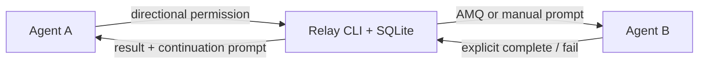

# Agent Relay

Windows-first local task handoffs for coding agents.

Agent Relay 把任务交接变成可追踪的本机工作流：明确谁可以向谁派发，保存 Markdown 请求，等待显式完成事件，失败后可以检查证据并恢复。请求方和接收方负责推理，Relay 负责传递和记账。



## 当前能力

- 稳定 Agent ID、只读路径发现、手工纠正和路径验证。
- A→B 有向权限；B 的完成回调不自动获得 B→A 派发权。
- `auto`、`confirm`、`manual` 派发，持久任务、尝试、幂等和审计。
- AMQ 公共 CLI 适配器；显式验证后自动入队，不建立常驻收件服务。
- 显式 `ack`、`start`、`complete`、`fail`；写文件不会自动完成任务。
- 最多三次可证明未提交的运输重试；投递未知时停止自动重发。
- 默认三天的受管 Markdown 文件 TTL、预览清理、重启恢复与持久 Inbox。

阶段为 **Phase 1 — CLI Core**。本机 Windows 已完成 AMQ 0.104.0 收发及显式回调冒烟验证；两个真实 AI Agent 的自动执行闭环属于 Phase 2。精确交互会话恢复和桌面通知属于 Phase 3，MCP/迁移和 GUI 分别在 Phase 4/5。

## 构建与验证

需要 .NET 10 SDK；AMQ 为可选外部工具。核心不需要 GUI、服务或云端账号。

```powershell
git clone https://github.com/jason-namehard/agent-relay.git
cd agent-relay
dotnet restore --locked-mode
dotnet test --configuration Release --no-restore
pwsh ./scripts/check-licenses.ps1
pwsh ./scripts/publish.ps1
dotnet ./artifacts/relay/relay.dll --help
```

若 .NET 安装在独立位置，直接使用其 `dotnet.exe` 完整路径；打包脚本接受 `-Dotnet <path>`。发布结果为 framework-dependent CLI，需要 .NET 10 runtime。

## 第一次交接

命令返回 JSON。退出码 `4` 表示已保存但需要人工操作，`6` 表示投递未知，不能把这两种情况当成重新派发的理由。完整选项可运行任意命令的 `--help`。

```powershell
$relay = './artifacts/relay/relay.dll'
$dataRoot = Join-Path $PWD '.relay'
dotnet $relay --home $dataRoot init

# 使用真实、已确认的配置文件路径；validate 只读，不修改 Agent 配置。
dotnet $relay --home $dataRoot agent register --id agent-a --host codex --config-path C:/agents/a/config.toml
dotnet $relay --home $dataRoot agent register --id agent-b --host claude --config-path C:/agents/b/settings.json
dotnet $relay --home $dataRoot agent validate --id agent-a
dotnet $relay --home $dataRoot agent validate --id agent-b
dotnet $relay --home $dataRoot permission set --from agent-a --to agent-b --decision allow

$handoff = dotnet $relay --home $dataRoot task dispatch --from agent-a --to agent-b --request ./request.md --mode manual --idempotency-key review-1 | ConvertFrom-Json
$task = $handoff.data.task
$handoff.data.prompt
```

把请求提示词交给 B，A 随即结束当前轮。B 读取请求，把结果写入响应中的 `result_path`，再显式回调：

```powershell
dotnet $relay --home $dataRoot task ack --task $task.task_id --attempt $task.attempt_id --sender agent-b --idempotency-key ack-1

# B 完成实际工作后写结果；也可用 artifact register 导入外部结果文件。
dotnet $relay --home $dataRoot task complete --task $task.task_id --attempt $task.attempt_id --sender agent-b --status succeeded --result $task.result_path --idempotency-key done-1
dotnet $relay --home $dataRoot prompt show --task $task.task_id
```

若工作失败，使用 `task fail --status failed --error-code <code> --message <reason> --result <failure-file>`，并同样提供 task、attempt、sender 和幂等键。

## 使用 AMQ 传输

从 [AMQ 官方 release](https://github.com/avivsinai/agent-message-queue/releases) 获取对应平台二进制后，显式指定可信文件。验证只在 Relay 自身目录创建测试队列，不安装插件、不启动 AI。

```powershell
dotnet $relay --home $dataRoot adapter verify --id amq-cli --executable C:/tools/amq/amq.exe
dotnet $relay --home $dataRoot task dispatch --from agent-a --to agent-b --request ./request.md --mode auto --adapter amq-cli --idempotency-key review-2
```

`dispatched` 表示 AMQ 已接受消息。B 仍需通过宿主集成或手工命令取件、执行并回调；此阶段不会假装已唤醒原会话。适配器不可用时保存为 `awaiting_manual`。AMQ 版本变化后必须重新验证。

## 超时、重试与清理

```powershell
dotnet $relay --home $dataRoot task status --task $task.task_id
dotnet $relay --home $dataRoot recover --task $task.task_id
dotnet $relay --home $dataRoot task evidence --task $task.task_id
dotnet $relay --home $dataRoot task retry --task $task.task_id --reason '已检查旧执行，批准重新执行' --approve
dotnet $relay --home $dataRoot cleanup --dry-run
dotnet $relay --home $dataRoot cleanup --apply
```

默认所有进程退出后不做后台工作；截止时间在下次 `recover` 时处理。`status` 只报告超时事实，不隐式投递。三天 TTL 只控制受管 Markdown 文件；SQLite 保留请求快照用于幂等比对和经批准的重试，并保留任务、事件、凭据和通知。清理不会删除数据库或宿主原始文件，也不承诺物理擦除。

## 已知边界

- 路径验证只证明文件存在、可读及登记关系，不声称宿主配置语法、认证和会话控制已通过验证。
- Phase 1 使用持久 Inbox 和复制提示词；尚未注册 Windows Task Scheduler、发送桌面通知或接入交互 session。
- `delivery_unknown` 保留凭据供人工核对；当前不自动对账或重发。取消只停止 Relay 后续动作，不终止已经启动的宿主。
- 清理覆盖登记产物；异常退出留下的未登记 workspace 文件按文件系统创建时间和当前 TTL 处理，不跟随目录链接。

## 文档与许可

[项目概要](docs/PROJECT_BRIEF.md) · [架构](docs/ARCHITECTURE.md) · [协议](docs/PROTOCOL.md) · [适配器](docs/ADAPTERS.md) · [UI 规格](docs/UI_SPEC.md) · [研究与路线图](docs/ROADMAP_AND_RESEARCH.md)

应用代码采用 [MIT License](LICENSE)。依赖和外部工具的来源、许可及分发说明见 [Third-party notices](THIRD_PARTY_NOTICES.md)。
