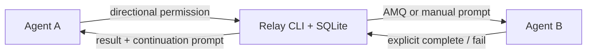
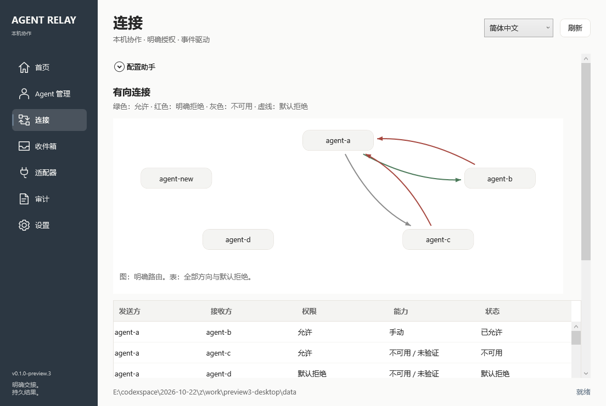

# Agent Relay

Windows-first local task handoffs for coding agents.

[](https://github.com/jason-namehard/agent-relay/actions/workflows/ci.yml)

**公开预览版：** [下载 v0.1.0-preview.5](https://github.com/jason-namehard/agent-relay/releases/tag/v0.1.0-preview.5) · [上手指南](docs/GETTING_STARTED.md) · [更新记录](CHANGELOG.md) · [参与贡献](CONTRIBUTING.md)

Windows 包解压后双击 **`TryDemo.cmd`** 即可体验隔离演示，无需模型账号；结果是明确标注的本地样本。正式接入先登记路径、验证并授权，CLI/MCP 另需 .NET 10 runtime。

桌面支持英语、简体中文、繁体中文、日语、韩语和西班牙语，覆盖配置提示词、任务提示词、通知与配置解析错误。右上角和设置页均可即时切换语言；设置页提供四套莫兰迪配色，选择即保存，强调色可预览后单独保存。每个配置输入旁可复制提示词，让目标 Agent 以固定 JSON 回复，再粘贴解析代填；登记、验证与批准各自独立。见 [配置助手与外观](docs/CONFIGURATION_ASSISTANT.md)。

Agent Relay 把任务交接变成可追踪的本机工作流：明确谁可以向谁派发，保存 Markdown 请求，等待显式完成事件，失败后可以检查证据并恢复。请求方和接收方负责推理，Relay 负责传递和记账。



## 当前能力

- 稳定 Agent ID、只读路径发现、手工纠正和路径验证。
- A→B 有向权限；B 的完成回调不自动获得 B→A 派发权。
- `auto`、`confirm`、`manual` 派发，持久任务、尝试、幂等和审计。
- AMQ 公共 CLI 适配器；显式验证后自动入队，不建立常驻收件服务。
- `codex-exec` 单次执行器：领取 AMQ 消息、启动独立只读 CLI、验证结构化声明并提交完成/失败。
- 显式 `ack`、`start`、`complete`、`fail`；写文件不会自动完成任务。
- 最多三次可证明未提交的运输重试；投递未知时停止自动重发。
- 默认三天的受管 Markdown 文件 TTL、预览清理、重启恢复与持久 Inbox。
- 精确 Codex 会话继续：`codex-queue` 保存提交回执，`codex-exec-resume` 验证原 UUID 的一次完成轮次。
- Windows 本地通知、关闭程序后的点击激活、提示词窗口和一键复制；继续提交独立去重。
- stdio MCP 的七个任务工具，启动时绑定 Agent 身份，与 CLI 共用方向权限和完成契约。
- JSON/TOML 配置迁移的精确预览、来源版本登记、备份、明确批准、验证、独立停旧和回滚。

当前为 **0.1.0-preview.5**，覆盖 CLI、MCP 和 Windows GUI。原生 WPF 界面提供 Agent 登记、方向连接图、Inbox、任务证据、适配器验证、迁移审阅和设置；首次使用可直接体验隔离 Demo。核心 131 项自动回归与 Windows 125 项窗口交互验证通过；各入口共用同一个账本，无常驻服务或轮询依赖。

## Windows 桌面界面

Windows 分发包中运行 `gui/AgentRelay.Desktop.exe`。默认数据目录与 CLI 相同，也可显式指定：

```powershell
./gui/AgentRelay.Desktop.exe --home C:/relay-data
```

界面启动做一次恢复；外部进程更新账本时，Home/Inbox 自动读取，编辑页面保留草稿并在独立底栏提示刷新，不覆盖刚完成操作的结果。连接图以绿色、红色、灰色区分允许、明确拒绝和不可用；4 个及以上 Agent 只绘制明确设置的权限，完整方向与默认拒绝仍可在下方表格查看。配置迁移显示精确片段，应用与回滚均需审阅、填写理由和明确批准。桌面交互见 [UI 规格](docs/UI_SPEC.md)，任务操作见 [Phase 5](docs/PHASE5.md)。



从源码构建 Windows 组件：

```powershell
dotnet restore src/AgentRelay.Notify/AgentRelay.Notify.csproj --locked-mode
pwsh ./scripts/test-desktop.ps1
pwsh ./scripts/check-licenses.ps1 -IncludeDesktop
pwsh ./scripts/publish.ps1 -IncludeDesktop
```

GUI 和通知程序自带运行库；CLI、MCP 仍需要 .NET 10 runtime。窗口交互测试只使用专用配置与模拟任务，不调用模型。

## 构建与验证

需要 .NET 10 SDK；AMQ 为可选外部工具。核心不需要 GUI、服务或云端账号。

```powershell
git clone https://github.com/jason-namehard/agent-relay.git
cd agent-relay
dotnet restore --locked-mode
dotnet test --configuration Release --no-restore
pwsh ./scripts/check-licenses.ps1
pwsh ./scripts/publish.ps1
dotnet ./artifacts/relay/relay.dll --help
```

若 .NET 安装在独立位置，直接使用其 `dotnet.exe` 完整路径；打包脚本接受 `-Dotnet <path>`。发布结果为 framework-dependent CLI，需要 .NET 10 runtime。

## 第一次交接

命令返回 JSON。退出码 `4` 表示已保存但需要人工操作，`6` 表示投递未知，不能把这两种情况当成重新派发的理由。完整选项可运行任意命令的 `--help`。

```powershell
$relay = './artifacts/relay/relay.dll'
$dataRoot = Join-Path $PWD '.relay'
dotnet $relay --home $dataRoot init

# 使用真实、已确认的配置文件路径；validate 只读，不修改 Agent 配置。
dotnet $relay --home $dataRoot agent register --id agent-a --host codex --config-path C:/agents/a/config.toml
dotnet $relay --home $dataRoot agent register --id agent-b --host claude --config-path C:/agents/b/settings.json
dotnet $relay --home $dataRoot agent validate --id agent-a
dotnet $relay --home $dataRoot agent validate --id agent-b
dotnet $relay --home $dataRoot permission set --from agent-a --to agent-b --decision allow

$handoff = dotnet $relay --home $dataRoot task dispatch --from agent-a --to agent-b --request ./request.md --mode manual --idempotency-key review-1 | ConvertFrom-Json
$task = $handoff.data.task
$handoff.data.prompt
```

把请求提示词交给 B，A 随即结束当前轮。B 读取请求，把结果写入响应中的 `result_path`，再显式回调：

```powershell
dotnet $relay --home $dataRoot task ack --task $task.task_id --attempt $task.attempt_id --sender agent-b --idempotency-key ack-1

# B 完成实际工作后写结果；也可用 artifact register 导入外部结果文件。
dotnet $relay --home $dataRoot task complete --task $task.task_id --attempt $task.attempt_id --sender agent-b --status succeeded --result $task.result_path --idempotency-key done-1
dotnet $relay --home $dataRoot prompt show --task $task.task_id
```

若工作失败，使用 `task fail --status failed --error-code <code> --message <reason> --result <failure-file>`，并同样提供 task、attempt、sender 和幂等键。

## 使用 AMQ 传输

从 [AMQ 官方 release](https://github.com/avivsinai/agent-message-queue/releases) 获取对应平台二进制后，显式指定可信文件。验证只在 Relay 自身目录创建测试队列，不安装插件、不启动 AI。

```powershell
dotnet $relay --home $dataRoot adapter verify --id amq-cli --executable C:/tools/amq/amq.exe
dotnet $relay --home $dataRoot task dispatch --from agent-a --to agent-b --request ./request.md --mode auto --adapter amq-cli --idempotency-key review-2
```

`dispatched` 表示 AMQ 已接受消息。B 仍需通过宿主集成或手工命令取件、执行并回调；此阶段不会假装已唤醒原会话。适配器不可用时保存为 `awaiting_manual`。AMQ 版本变化后必须重新验证。

## 自动运行一次 Codex Agent

已有数据目录升级后先运行一次 `init`，以创建新增记录表；已有任务、权限和配置保留。指定原生 `codex.exe`，不用 npm 的 `.cmd`/`.ps1` 启动脚本。

```powershell
dotnet $relay --home $dataRoot init
dotnet $relay --home $dataRoot agent register --id agent-b --host codex --config-path C:/Users/you/.codex/config.toml --cli-path C:/tools/codex.exe
dotnet $relay --home $dataRoot agent validate --id agent-b
dotnet $relay --home $dataRoot agent verify-executor --id agent-b

$handoff = dotnet $relay --home $dataRoot task dispatch --from agent-a --to agent-b --request ./request.md --mode auto --adapter amq-cli --idempotency-key review-3 --execute --execution-timeout-seconds 300 | ConvertFrom-Json
$task = $handoff.data.task
```

派发立即返回等待响应，A 结束当前轮。单次 worker 根据运输凭据领取精确消息，确认当前尝试并启动 B，收到 B 的结构化 `succeeded/failed` 声明后显式调用已有完成/失败操作。worker 在任务处理后退出；退出码 `0`、文件变化或 AMQ 收件回执都不能单独表示任务成功。

执行器使用注册配置文件所在目录作为 `CODEX_HOME`，复用该目录的已有登录态。B 的新任务固定以 `--ignore-user-config --ephemeral --sandbox read-only` 调用，不加载用户 config.toml 的模型/provider/MCP 设置。适用于已登录 Codex 的只读分析和文本结果任务；自定义 provider/profile 及写入代码的执行模式尚未接入。

需要人工确认时使用 `task dispatch --mode confirm`，再显式 `task approve --task <id> --execute`。也可独立运行单次 worker：

```powershell
dotnet $relay --home $dataRoot task run --task $task.task_id --attempt $task.attempt_id --sender agent-b --timeout-seconds 300
dotnet $relay --home $dataRoot task execution --task $task.task_id
```

同一任务尝试只有一个执行领取者；重复 `run` 或重复派发不会再启动模型。执行结果未知时只展示证据；经明确批准的 `task retry` 产生新尝试，再显式运行 worker。日志、结果声明和后台 worker 报告位于该尝试的受管目录，按文件 TTL 清理。

两个真实 CLI 的可复现验证脚本需要本机已有认证，会消耗账户模型额度；普通 CI 不调用模型或读取登录凭据：

```powershell
pwsh ./scripts/verify-real-agents.ps1 -Dotnet dotnet -Codex C:/tools/codex.exe -Amq C:/tools/amq/amq.exe -ConfigPath C:/Users/you/.codex/config.toml
```

## 自动继续原会话与桌面通知

先为 A 登记并验证原生 CLI 路径，再选择会话继续方式。`codex-queue` 只提交消息给宿主；若希望在已结束的 CLI 会话内运行一次只读轮次，显式选择 `codex-exec-resume`，会消耗模型额度。两种方式不自动互相替换。

```powershell
dotnet $relay --home $dataRoot agent verify-resumer --id agent-a --kind codex-queue
```

派发时提供 `--origin-session ./origin.json`，文件包含 `host`、精确 UUID `session_id`、登记的 `config.toml` 绝对路径 `config_profile` 和绝对 `cwd`。Relay 保存适配器快照，继续前核对配置、版本和 session 元数据；不选择最近会话。完成回调先保存结果，再处理继续 outbox。`submitted` 只代表提交回执，`completed` 才表示原 UUID 的一次新轮次有完成证据。

Windows 通知是可选独立组件，按以下命令构建并登记：

```powershell
dotnet restore src/AgentRelay.Notify/AgentRelay.Notify.csproj --locked-mode
pwsh ./scripts/check-licenses.ps1 -IncludeDesktop
pwsh ./scripts/publish.ps1 -IncludeDesktop
dotnet $relay --home $dataRoot desktop configure --executable ./artifacts/relay/desktop/AgentRelay.Notify.exe

dotnet $relay --home $dataRoot task continuations --task $task.task_id
dotnet $relay --home $dataRoot prompt open --task $task.task_id
dotnet $relay --home $dataRoot prompt copy --task $task.task_id
```

没有会话绑定、恢复失败或提交未知时，已配置的 Windows 辅助程序发送本地通知；可打开任务提示词窗口或直接复制。程序退出后由 Windows 点击激活，无常驻 Relay 服务。首次通知会注册该程序的当前用户应用标识和 COM 入口，请保留发布目录位置；停用与卸除说明、`origin.json` 示例和故障语义见 [Phase 3](docs/PHASE3.md)。Windows 二进制中的微软组件按独立条款分发，使用前见 [分发条款](DISTRIBUTION_TERMS.md)。

验证真实 A→B→原 A 闭环可给 `verify-real-agents.ps1` 添加 `-ResumeOrigin`。它创建独立测试会话，检查旧上下文标记、B 的结果和重复继续去重；不向用户当前聊天投递消息。

## stdio MCP 与配置迁移

发布包在 `mcp/` 提供独立 MCP 入口。宿主为每个 Agent 启动一个实例，共用同一个 Relay 数据目录：

```powershell
dotnet ./artifacts/relay/mcp/relay-mcp.dll --home $dataRoot --agent agent-a
```

MCP 提供派发、ack、start、complete、fail、单次 status 和提示词七个工具。身份在启动时固定，模型不能用参数切换派发方或回调方；不会暴露修改权限、批准迁移或无限等待工具。`execute=true` 可启动独立的单次 worker，MCP 客户端关闭后仍能提交结果和继续原会话。

已有配置先只读盘点，再生成准确的变更提案：

```powershell
dotnet $relay --home $dataRoot adapter inspect-config --path C:/Users/you/.codex/config.toml --format toml
dotnet $relay --home $dataRoot migration plan --manifest ./migration.json
dotnet $relay --home $dataRoot migration show --id <migration-UUID>
```

预览不修改配置；应用和回滚须在审阅后显式 `--approve --reason`。JSON/TOML 以唯一精确片段变更，保留 BOM、换行和无关内容；文件已变化则停止。旧入口须引用已验证的新迁移，单独提案、单独批准停用。备份位于数据目录的 `migrations/`，不受三天 TTL 清理。完整 manifest、MCP 参数、证据与恢复流程见 [Phase 4 指南](docs/PHASE4.md)。

真实闭环验证可给 `verify-real-agents.ps1` 添加 `-McpMigration`，它只修改独立测试配置，验证 MCP 派发、真实完成与原会话继续，再验证单独停旧和回滚；会消耗模型额度。

## 超时、重试与清理

```powershell
dotnet $relay --home $dataRoot task status --task $task.task_id
dotnet $relay --home $dataRoot recover --task $task.task_id
dotnet $relay --home $dataRoot task evidence --task $task.task_id
dotnet $relay --home $dataRoot task retry --task $task.task_id --reason '已检查旧执行，批准重新执行' --approve
dotnet $relay --home $dataRoot cleanup --dry-run
dotnet $relay --home $dataRoot cleanup --apply
```

默认所有进程退出后不做后台工作；截止时间在下次 `recover` 时处理。`status` 只报告超时事实，不隐式投递。三天 TTL 只控制受管 Markdown 文件；SQLite 保留请求快照用于幂等比对和经批准的重试，并保留任务、事件、凭据和通知。清理不会删除数据库或宿主原始文件，也不承诺物理擦除。

## 已知边界

- 路径验证只证明文件存在、可读及登记关系，不声称宿主配置语法、认证和会话控制已通过验证。
- 尚未注册 Windows Task Scheduler；所有进程退出后，截止时间在下次 `recover` 处理。通知被系统接受不保证横幅可见。
- 真实会话恢复仅验证当前 Codex 版本；Claude 与其他宿主使用持久 Inbox 和复制提示词。
- `delivery_unknown` 保留凭据供人工核对；当前不自动对账或重发。取消只停止 Relay 后续动作，不终止已经启动的宿主。
- 清理覆盖登记产物；异常退出留下的未登记 workspace 文件按文件系统创建时间和当前 TTL 处理，不跟随目录链接。

## 文档与许可

[项目概要](docs/PROJECT_BRIEF.md) · [架构](docs/ARCHITECTURE.md) · [协议](docs/PROTOCOL.md) · [适配器](docs/ADAPTERS.md) · [UI 规格](docs/UI_SPEC.md) · [研究与路线图](docs/ROADMAP_AND_RESEARCH.md)

[Phase 1 验收](docs/PHASE1.md) · [Phase 2 验收](docs/PHASE2.md) · [Phase 3 验收](docs/PHASE3.md)

[Phase 4 使用与验收](docs/PHASE4.md) · [Phase 5 桌面指南](docs/PHASE5.md)

应用代码采用 [MIT License](LICENSE)。依赖和外部工具的来源、许可及分发说明见 [Third-party notices](THIRD_PARTY_NOTICES.md)。
