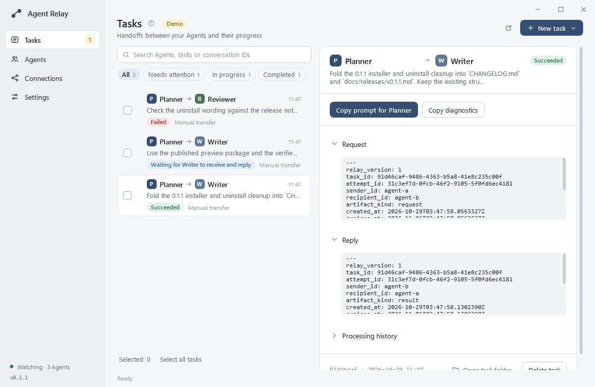
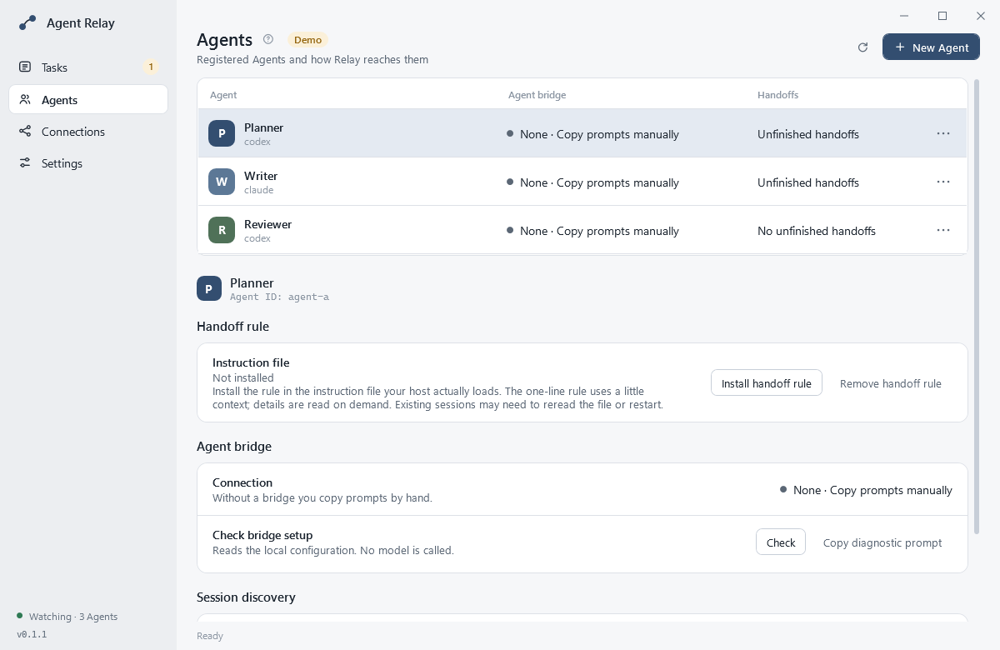
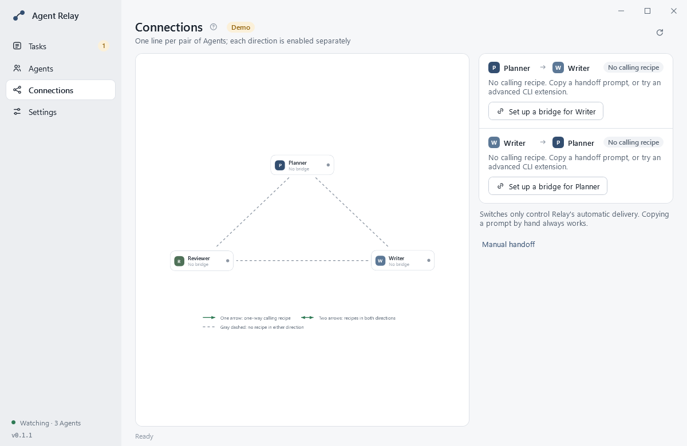
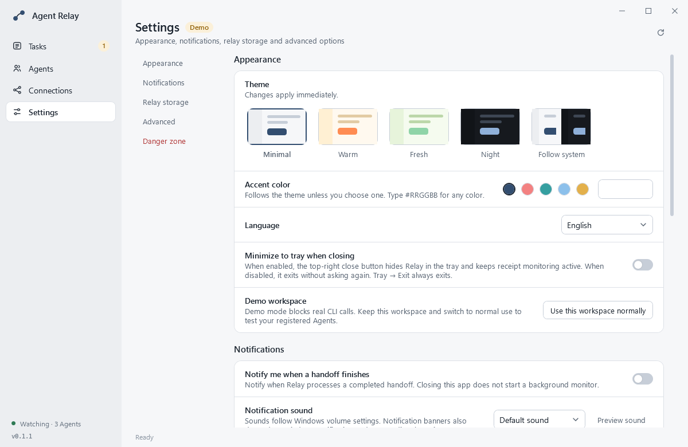

# Agent Relay

[English](README.md) | **简体中文**

[](https://github.com/jason-namehard/agent-relay/actions/workflows/ci.yml)
[](https://github.com/jason-namehard/agent-relay/releases)
[](LICENSE)

给同时使用多个 AI Agent 的人准备的本机交接台：把文件或请求从 A 交给 B，随时看清现在由谁处理，工作真正完成时才结束这一轮。



同时用几个 Agent 时，工作通常靠复制粘贴推进：把请求贴进一个会话，等它回答，再把答案抄到另一个会话。很快你就分不清哪个会话收到了什么、对方有没有接手、文件变了是不是就代表做完了。Agent Relay 把每次交接记成本机中转站里的一条任务（SQLite 账本），在 Windows 桌面程序中展示进度，并把「消息已提交」和「任务已凭回执完成」分开。Agent 和分工由你决定，Relay 只需要知道谁交给谁。

当前版本为 `0.1.2`，提供 Windows x64 桌面安装包。CLI 与 stdio MCP 有 Windows 和 Linux 的 CI 覆盖。没有 macOS 桌面包、云端中转站，也没有在所有进程关闭后继续运行的后台服务。

## 快速开始

### Windows 安装包

从 [发布页](https://github.com/jason-namehard/agent-relay/releases/tag/v0.1.2) 下载 Windows x64 安装包，也可以在 PowerShell 运行：

```powershell
Invoke-WebRequest 'https://github.com/jason-namehard/agent-relay/releases/download/v0.1.2/AgentRelay-v0.1.2-windows-x64-setup.exe' -UseBasicParsing -OutFile 'AgentRelay-setup.exe'
Start-Process '.\AgentRelay-setup.exe' -Wait
```

安装包没有代码签名，默认按当前用户安装到 `%LOCALAPPDATA%\Programs\Agent Relay`；桌面程序、CLI 和 MCP 都自带 .NET 运行库。安装后从开始菜单启动，或运行：

```powershell
& "$env:LOCALAPPDATA\Programs\Agent Relay\app\gui\AgentRelay.Desktop.exe"
& "$env:LOCALAPPDATA\Programs\Agent Relay\app\relay.exe" --help    # app\mcp\relay-mcp.exe 同样是自包含的
```

按 0.1.1 和 0.1.2 源码分别构建的隔离安装包已通过覆盖升级测试。卸载测试覆盖了保留数据、移除规则、清除账本、规则损坏及位置记录缺失；两个原始交付安装包之间的升级尚未在隔离虚拟机中实测。升级前请先从托盘退出 Agent Relay。

### 旧预览版 `0.1.0-preview.22`

从 [Release 页面](https://github.com/jason-namehard/agent-relay/releases/tag/v0.1.0-preview.22) 下载，或用 PowerShell。请把压缩包完整解压到新目录，不要在 ZIP 里直接运行。

```powershell
$version = 'v0.1.0-preview.22'
$zip = "AgentRelay-$version-windows-x64.zip"
$ProgressPreference = 'SilentlyContinue'
Invoke-WebRequest "https://github.com/jason-namehard/agent-relay/releases/download/$version/$zip" -UseBasicParsing -OutFile $zip
Expand-Archive $zip -DestinationPath ".\AgentRelay-$version"
Set-Location ".\AgentRelay-$version"

.\TryDemo.cmd                    # 隔离演示：样本 Agent 与预设任务，无需模型账号，不调用模型
.\gui\AgentRelay.Desktop.exe     # 正式使用
```

<details>
<summary>核对下载的 ZIP 与 GitHub 资产摘要是否一致</summary>

```powershell
$release = Invoke-RestMethod "https://api.github.com/repos/jason-namehard/agent-relay/releases/tags/$version"
$asset = $release.assets | Where-Object name -eq $zip
if (-not $asset.digest) { throw 'The release API did not provide an asset digest.' }
$actual = 'sha256:' + (Get-FileHash -LiteralPath $zip -Algorithm SHA256).Hash.ToLowerInvariant()
if ($actual -ne $asset.digest) { throw 'The file does not match the GitHub asset.' }
```

本地构建与 CI 构建不保证逐字节可复现。

</details>

运行要求：安装版的桌面程序、CLI 与 MCP 都自带运行库；便携 ZIP 的 CLI 与 MCP（`relay.dll`、`mcp\relay-mcp.dll`）需要 [.NET 10 runtime](https://dotnet.microsoft.com/download/dotnet/10.0)。没有代码签名，Windows 可能给出安全提示。「无需账号」指的是 Relay 自身和演示；接入的 Agent 仍按各自宿主的账号、权限和模型计费。

## 四个主页面



| 页面 | 作用 |
| --- | --- |
| 任务 | 左侧列表、右侧详情。新建自动或手动传递任务，集中查看请求、回复与处理记录，按「全部 / 需要处理 / 进行中 / 已完成」筛选，可多选后批量操作。 |
| Agent 管理 | 用任意名称登记发送方和接收方。一键配置会检查本机宿主并导入调用方式；手动字段始终可用。每行有编辑、测试、恢复和删除入口，详情里显示桥接状态与可选的一行交接规则。 |
| 连接图 | 每对 Agent 一条线。箭头表示哪些方向有已验证的调用方式，绿/红表示各方向是否启用，灰色虚线表示没有方案。点击连线用开关分别管理两个方向；手动复制始终可用。 |
| 设置 | 外观（五种主题、强调色、六种语言）、通知与提示音、中转站位置、保留期、高级时限和危险操作。修改即时生效。 |



## 一次交接怎么走

### 自动 CLI 传递

1. 登记 A 和 B。**新建 Agent → 一键配置** 会读取 CLI 帮助和非敏感设置，能导入调用方式时直接导入；本机接口跑不起来时改用手动字段，不必粘贴一整段配置块。
2. 选择 **新建任务 → 新建自动传递任务**。选 A（可选来源会话；没有来源会话时，交给 A 的那一轮需要手动复制）、选 B，指定新会话或已有会话，填写工作正文；Relay 准备提示词并调用所选 CLI。
3. 选择 **单次交接**（B 完成后结束）或 **持续修改直到验收通过**。持续验收时指定最终验收方，手动填写验收标准或让发起方 Agent 拟定，并可按需设置验收次数上限。验收方会提出具体修改或确认通过且无待解决事项；Relay 记录这个结论，但不独立验证工作质量。
4. 创建任务。尚未启用的方向需要你明确允许，因为自动发送要求该 Agent 的能力已验证。看板显示当前处理者、角色、轮次和阶段。后续轮次续接精确绑定的会话；会话丢失时 Relay 会请你另行选择，而不是退回最近的对话。



### 手动传递

1. **新建任务 → 新建手动传递任务**，选择发送方和接收方，填写请求，复制给发送方的提示词并粘贴到它的会话。
2. 把发送方返回的 JSON 粘贴回 Relay 解析创建任务，也可以直接选择一个已有文件。
3. 按看板提示复制下一段提示词给当前处理方。Relay 运行时与刷新时读取回执；按实际需要继续传递，整项任务明确完成后才结束。
4. 可选地把一行交接规则写入宿主实际读取的指令文件。Relay 不会静默修改该文件：写入前先让你看到这一行；详细指引按需读取。

结果文件出现或被修改都不会完成任务。任务状态只由有效回执改变，或由你明确点击「标记传递完成」（记录的是用户决定）。CLI 投递结果不确定时先检查目标会话；确认未收到后点「确认未收到 · 允许重发」再发送一次，Relay 不会自动重试。

## 包含什么

| 方面 | 当前实现 |
| --- | --- |
| 任务看板 | 直接填写 CLI 工作请求或文件交接、明确会话、单次交接或验收循环、暂停后的处理决定、批量选择与任务控制 |
| 会话 | 按任务、尝试、轮次和 Agent 记录 SQLite 绑定；定向发现、显示缓存与续接前的重新核对 |
| Agent 录入 | 一个名称、一键配置、独立的手动字段，以及本机配置端点 |
| 交接规则 | 可选的一行规则，写入前展示，详情按需读取，移除时保留你的其他修改 |
| 连接图 | 方向箭头、各方向开关，节点圆点区分已登记方案、探针失败和无方案 |
| CLI 扩充 | 原生 JSON、JSONL 与最终文本输出的适配；新会话探针与续接探针分开记录 |
| 存储 | 本机中转站、保留期清理、迁移时先复制校验再切换 |
| 外观 | 极简、暖色、清新、夜间与跟随系统五种主题；强调色；英语、简体中文、繁体中文、日语、韩语、西班牙语 |
| 通知 | 可选的 Windows 辅助程序与可选提示音；Relay 运行时显示应用内提醒 |
| 卸载 | 按用户安装的 Windows 安装包；卸载默认保留数据，也可只移除规则，或清除账本与偏好并保留工作区文件 |

## 桥接、验证与费用

桥接有三种：ACP、正在运行的桌面程序自身接口（DSH 为 `dsh-desktop`）、宿主自己的 CLI。Relay 适配原生 JSON、JSONL 和最终文本输出，宿主不必输出 Relay 的私有回执格式。

- 通过桥接手动发送只需已登记的调用方式和已启用的方向。**自动**投递还要求任务开启自动，且能力已验证：探针通过（Agent 写出标记文件，并由你确认会话可见），或一次真实交接经该方案送达且 Agent 写回了回执。
- 探针会真实调用 CLI，可能产生费用。登录被拒、未选模型或缺少工具权限会停止该 Agent 的自动投递，处理后在 Agent 管理点击「我已处理 · 允许自动发送」。
- 续接会话需要精确绑定、重新核对宿主存储，并让响应中的会话 ID 与绑定一致。Relay 不让模型自行发现会话 ID，也不会把隐藏对话变成可见。
- Zcode 在 CLI 投递后可能仍在内存里显示旧的对话内容。切到其他会话约 11 分钟后再回来，或保存工作后重启 Zcode；旧视图不代表投递失败。
- Relay 会让已知宿主的请求前缀保持一致，使切换后提示缓存继续命中：Zcode 按启动参数对齐，Hermes 经其共享网关，DSH 走正在运行的桌面接口。切换后实测缓存命中率为 93–99%。`cli-recipe doctor` 会报告与桌面不一致的启动设置，`agent cache-check` 显示每次请求的缓存命中；其他宿主可由一键配置把内置的 `relay-cache-parity` 技能交给正在配置的 Agent。
- WorkBuddy 在这里没有可用的外部接口，交给它的交接需要手动复制。

## 开发

<details>
<summary>从源码构建与测试</summary>

需要 .NET 10 SDK（见 `global.json`）。在全新克隆中，用 PowerShell：

```powershell
git clone https://github.com/jason-namehard/agent-relay.git
cd agent-relay
dotnet restore --locked-mode
dotnet test --configuration Release --no-restore
```

覆盖 Core、CLI、MCP 与核心测试。桌面程序与通知辅助程序需在 Windows 上单独构建（PowerShell 7）：

```powershell
dotnet restore src/AgentRelay.Notify/AgentRelay.Notify.csproj --locked-mode
pwsh ./scripts/test-desktop.ps1
pwsh ./scripts/check-licenses.ps1 -IncludeDesktop
pwsh ./scripts/package.ps1 -Flavor Windows
```

安装包用 Inno Setup 构建：`pwsh ./scripts/build-installer.ps1`（`dotnet` 或 `ISCC.exe` 不在 `PATH` 时用 `-Dotnet`、`-InnoCompiler` 传入路径）。脚本都接受 `-Dotnet <路径>`；发布包输出到 `artifacts/packages`，不覆盖同名文件。常规测试只用本地样本，不调用付费模型。

</details>

<details>
<summary>CLI 与 stdio MCP</summary>

`dotnet .\relay.dll --help` 列出命令；MCP 服务不支持 `--help`。宿主为每个 Agent 启动一个 MCP 实例：

```powershell
dotnet .\mcp\relay-mcp.dll --home <中转站目录> --agent <已登记的 Agent ID>
```

工具：`relay_task_dispatch`、`relay_task_ack`、`relay_task_start`、`relay_task_complete`、`relay_task_fail`、`relay_task_status`、`relay_prompt_show`。调用方身份在启动时固定。

</details>

<details>
<summary>中转站目录的确定顺序</summary>

| 程序 | 顺序 |
| --- | --- |
| CLI、MCP | `--home` → `RELAY_HOME` → `%LOCALAPPDATA%\AgentRelay` |
| 桌面程序 | `--home` → `RELAY_HOME` → 设置页选定的目录 → `%LOCALAPPDATA%\AgentRelay` |
| 演示 | `%LOCALAPPDATA%\AgentRelay.Demos\` 下的新目录 |

在设置页迁移中转站后，CLI 和 MCP 需要指向新的 `--home`，已复制的交接提示词也要重新复制。受管文件超过保留期（默认 3 天）会被清理；长期成果请保存在项目目录。

</details>

## 已知限制

- 预览软件，确有缺口：真实宿主的会话创建、可见性与续接需要在该宿主中实际测试；模拟桥接不构成真实集成证据。Windows 不同显示缩放和多显示器下的表现仍需人工检查。
- 没有后台服务或计划任务。桌面程序运行时才监控回执；所有进程关闭后，超时工作要等下次 `relay recover`（CLI）或下次启动。
- 卸载清理只覆盖当前中转站登记的规则；用过的其他站点需要分别处理。删除安装目录或解压目录都不能代替卸载或移除规则。
- 取消任务只结束 Relay 的跟踪和后续投递，不会终止已经在工作的 Agent。删除任务会移除账本记录，文件保留到后续清理。

[上手指南](docs/GETTING_STARTED.md) · [配置与回执](docs/CONFIGURATION_ASSISTANT.md) · [会话管理](docs/SESSIONS.md) · [架构](docs/ARCHITECTURE.md) · [UI 规格](docs/UI_SPEC.md) · [适配器](docs/ADAPTERS.md) · [贡献指南](CONTRIBUTING.md) · [更新记录](CHANGELOG.md) · [Issues](https://github.com/jason-namehard/agent-relay/issues)

## 许可

项目代码采用 [MIT](LICENSE)。Windows 发布包与安装包还再分发了 .NET 运行库、Windows App SDK 等组件，它们适用各自的条款：[分发条款](DISTRIBUTION_TERMS.md)、[第三方声明](THIRD_PARTY_NOTICES.md) 和 `licenses/`。
