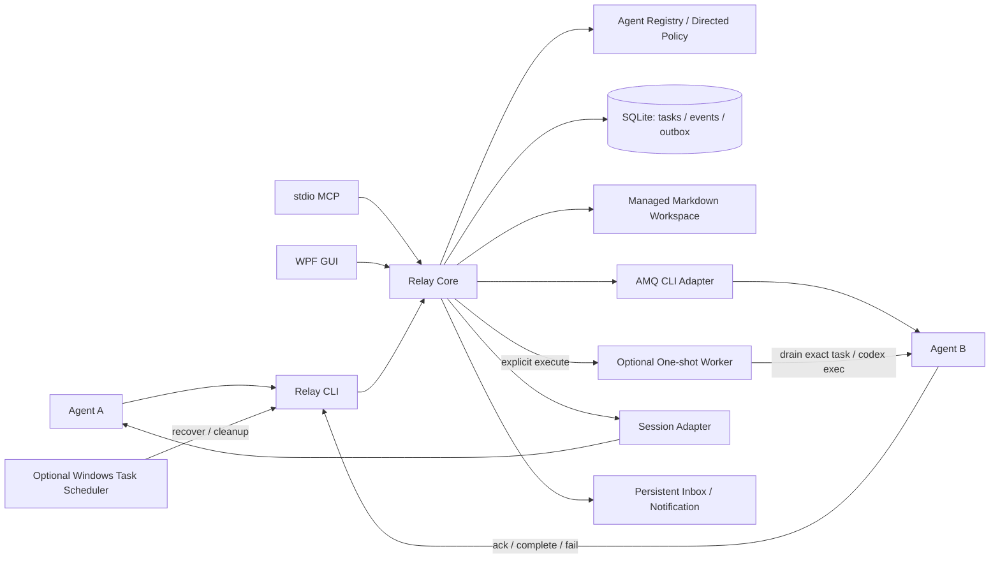
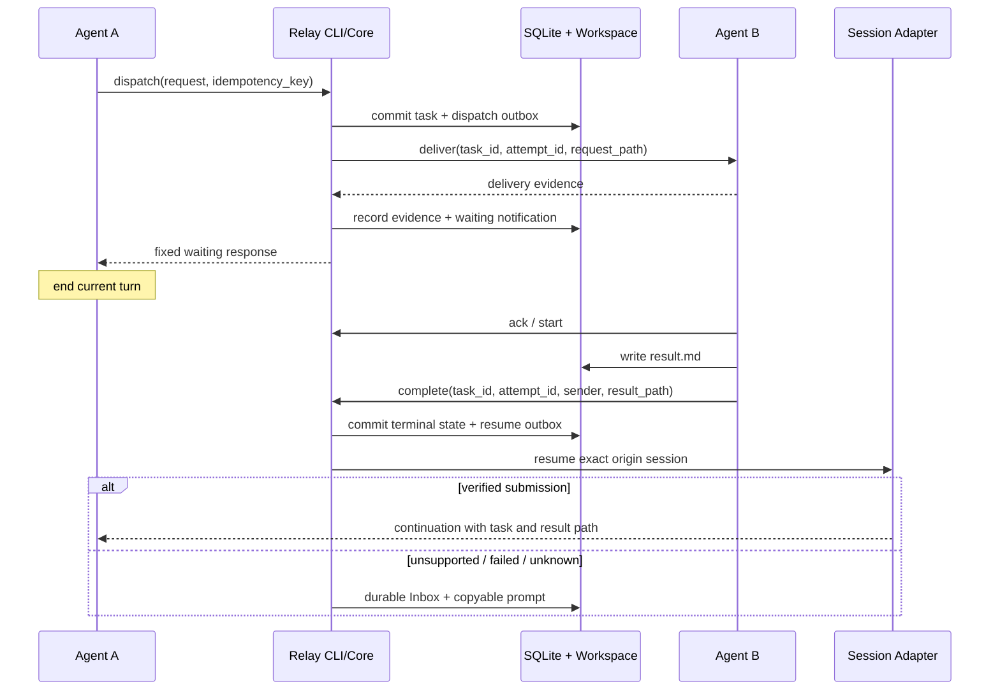

# Agent Relay 架构

状态：已批准架构；Phase 2 单次真实 CLI 执行落地。实际能力见 [PHASE1](PHASE1.md) 和 [PHASE2](PHASE2.md)。协议字段和状态以 [PROTOCOL](PROTOCOL.md) 为准。

## 组件与依赖方向

建议 `.NET 10` 核心库共享业务操作；CLI、stdio MCP、WPF GUI 只做输入输出。核心依赖抽象适配器，不依赖 GUI、宿主会话文件格式或 AMQ 内部包。

AMQ 负责消息文件、收件和回执；Relay SQLite 是任务状态、权限、尝试次数和通知状态的唯一权威。AMQ 的收件回执不能替代 `task.completed`。AMQ 自动唤醒不是核心依赖；如果 B 无可验证的自动执行入口，消息入队后也不能标为已开始执行。

## 默认运行方式

1. A 在受管任务目录生成请求，调用 `relay task dispatch`。Core 检查已验证路径、A→B 权限、适配器能力和幂等键，先提交任务与待投递 outbox。
2. CLI 领取一次投递尝试并退出数据库事务，再执行 AMQ 或宿主调用。`accepted` 写入运输凭据；明确未提交才可有限重试；不确定则进入 `delivery_unknown`。
3. 返回固定等待响应。A 结束当前轮，不调用循环状态工具。`awaiting_manual` 必须明确提示用户仍需提交给 B。
4. B 显式 `ack` / `start`，完成文件写入后显式 `complete` 或 `fail`。Core 验证发送方、尝试和产物，在一个事务中提交结果、事件和待恢复通知。
5. 会话适配器尝试恢复 A 的精确会话；成功仅说明继续消息已提交。失败或不支持时，Inbox 保存继续提示词，并尝试 Windows 本地通知。

## 持久化与并发

建议账本位置 `%LOCALAPPDATA%\AgentRelay\relay.db`；临时目录 `%LOCALAPPDATA%\AgentRelay\workspace\<task_id>\`；AMQ 根目录在受管 `transport\amq\`，与 Git 工作区分离。`RELAY_HOME` 可显式覆盖本项目数据根目录，迁移须验证，不静默寻找替代目录。

SQLite 表包括 `settings`、`agents`、`permissions`、`adapters`、`tasks`、`callbacks`、`events`、`artifacts`、`outbox`、`notifications`，Phase 2 增加 `executors/executions`，Phase 3 增加 `resumers/continuations/desktop`。当前尝试保存在任务聚合内，旧尝试通过产物、回调和事件关联；迁移备份表留在 Phase 4。事件和当前状态同事务提交，写事务串行化并递增 `revision`，不另建事件溯源框架。幂等键用唯一约束，原始请求字段直接比较，不增加摘要层。

Phase 2 增加 `executors` 和 `executions`。后者以任务和尝试为唯一键，记录 worker、会话和领取租期，状态为 `scheduled → receiving → running → finished`；已证明启动失败为 `launch_failed`，无法确认结果为 `unknown`，旧结果不再适用为 `discarded`。后台 worker 不继承派发终端的输出管道，向受管报告文件输出；派发进程在启动后退出。

执行领取提交后崩溃，或执行时限内没有最终声明，恢复时保留未知状态并通知用户，不重启模型。任务整体截止时间仍由 `recover` 持久化为 `timed_out`。执行器代理已有显式回调操作，不从进程退出、产物更新或收件自动推断成功。

SQLite 事务中只做本地账本写入，不等待模型或外部 CLI。并发遇到锁超时时有限重试短事务，耗尽后明确报错。Microsoft 文档确认 SQLite 同时仅允许一个待提交写事务，见 [事务文档](https://learn.microsoft.com/en-us/dotnet/standard/data/sqlite/transactions)。

文件先写临时文件再同目录发布，随后登记引用。文件系统和 SQLite 不具备共同事务：未登记 workspace 文件按文件系统创建时间及当前 TTL 显式清理；已登记但文件缺失，报告缺失，不能伪造空结果。完成和清理通过写事务及产物删除标记协调；过期产物不能接受新的完成引用，必须重新提交新产物。

## 崩溃与未知投递

- outbox 提交后、调用前崩溃：领取标记不存在时可继续发送。
- 调用期间或调用成功后、凭据落盘前崩溃：恢复时将过期 `in_flight` 置为未知；先查供应方凭据，不盲目重发。
- AMQ 入队成功而会话提示失败：运输凭据保留，只恢复提示步骤，不重新创建消息。
- 完成事务提交后、通知前崩溃：`resume` outbox 保留，下次 `recover` 或事件触发继续处理。
- B 崩溃或没有回调：不从文件变化、进程退出码或收件回执推断成功；截止时间后进入 `timed_out` 并提供恢复入口。
- 注入超时同样可能已经被宿主接受；恢复通知标为未知，避免重复唤醒 A。

对外运输不能承诺 exactly-once；账本内幂等和 B 对 `task_id + attempt_id` 的执行去重共同约束重复副作用。

## 截止时间与清理

每个任务必须有 `deadline_at`。可选调度器为该任务注册一次 `relay recover --task <id>`，用于超时、通知或下一次有界重试；同时可注册启动/登录清理。Phase 0 只设计，不创建任何系统任务。

调度器注册失败要记录 `deadline_delivery=on_next_command` 并告知用户。无调度器且所有 Relay 进程退出时，系统没有执行主体，不能承诺即时超时通知。`status` 只读计算 `deadline_exceeded`；`recover` 持久化超时并处理 outbox。GUI 启动先做一次明确恢复；之后只响应事件、页面操作或用户刷新，不启动周期轮询。

TTL、过期活动任务、保留元数据和清理路径规则见 [PROTOCOL](PROTOCOL.md#ttl-与清理)。

## 权限与通知边界

任务派发每次检查 A→B。允许 B 对自己收到的任务确认、报错或完成，是任务范围内的回调权，不授予 B→A 新任务派发权。恢复 A 由 Relay 内部完成，不把 B 的任意文本当作新授权。

单用户本机协作模式下，CLI `--sender` 结合登记目标与当前尝试检查归属，不是操作系统级身份认证。能调用宿主原生命令的 Agent 仍可绕过 Relay；强制隔离需宿主沙箱或原生权限。

Inbox 通知与任务同事务保存，Windows 通知是附加输出。Phase 3 的独立 WPF 辅助程序复用 Windows App SDK `AppNotificationManager`，使用自包含运行库与当前用户注册；通知点击可在发送进程退出后激活。继续提交、桌面通知各有持久状态；关闭或免打扰不影响结果持久性。使用普通用户进程，微软当前不支持 elevated app notifications，见 [通知文档](https://learn.microsoft.com/en-us/windows/apps/develop/notifications/app-notifications/app-notifications-dotnet)。
