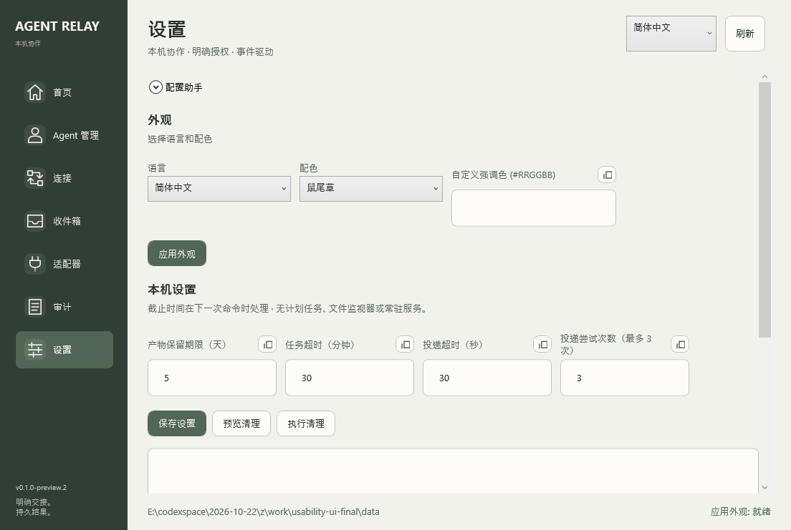

# 配置助手、语言与外观

## 语言和配色

窗口右上角的语言菜单可直接切换，无需先理解设置页。支持 English、简体中文、繁體中文、日本語、한국어、Español。首次跟随支持的系统语言，不匹配时用英语。设置页也提供语言、鼠尾草、暖陶、雾蓝、玫瑰灰四套莫兰迪配色，以及可选的 `#RRGGBB` 强调色。

点击“应用外观”后立即生效，同一数据目录重新打开时保持。自定义颜色过浅时，实际强调色会调整到能清楚显示白色按钮文字的深度；连接图的允许、明确拒绝和不可用语义色保持固定，并始终有文字。圆角控件、导航图标和配色使用原生 WPF，不增加第三方 UI 框架或图标素材。

偏好保存在当前 Relay 数据目录的 `desktop.preferences.json`，不写宿主配置。语言切换只处理界面、字段和已知状态；任务正文、原始 JSON、路径与外部诊断保留原文。坏的偏好文件会明确报错，不静默替换。

## 用 Agent 帮忙填写



Agent ID 是 Relay 内部标签，不是登录名，也不需要账号。可使用 `agent-codex`、`agent-claude` 等小写标签，之后仍可审阅和调整。

每个配置输入框旁都有复制图标。页面顶部的“配置助手”还能一次请求整组字段：

1. 点击字段旁复制图标，或展开“配置助手”点击“复制接入提示词”。
2. 将提示词粘贴给准备登记的 Agent。提示词要求只读核实本机路径与版本，不读取或输出认证、不修改配置、不请求联网或模型 API。
3. 将 Agent 的 JSON 回复复制回来，点击“粘贴 Agent 回复”，再点击“解析并填入”。
4. 检查代填内容，明确点击登记、验证或相关保存按钮。权限和迁移批准仍是单独动作。

助手适用于 Agent 登记、方向连接、适配器、迁移输入、设置和审计筛选。它只辅助表单输入，不会自动执行回复中的命令，也不填写批准理由或勾选批准框。

## 固定回复协议

以 Agent 登记为例：

```json
{
  "relay_setup_version": 1,
  "context": "agents",
  "fields": {
    "AgentId": "agent-codex",
    "AgentHost": "codex",
    "AgentConfig": "C:/Users/you/.codex/config.toml",
    "AgentCli": "C:/tools/codex.exe",
    "AgentVersion": "",
    "AgentInstructions": ""
  }
}
```

字段名和 context 不随语言变化，按复制提示词里的模板返回。只询问单字段时可以只返回那个字段；未知值留空，空白字符串不覆盖当前输入。原始路径按字符串保留，不猜测或执行。

回复必须是完整 JSON 对象，也允许一个完整的 `json` 代码围栏。最大 64 KiB UTF-8；自由说明、多个 JSON、未知字段、重复键、非字符串值、错误版本或错误上下文均会报错。解析先验证整个回复，失败不会半填表单。代填后仍需独立路径验证；Agent 的声明不能替代实际核验。
