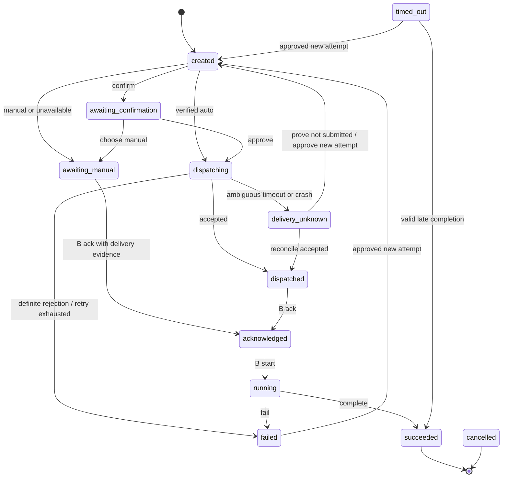

# Agent Relay 协议提案

状态：`relay_version: 1` 设计草案，尚无实现。跨进程 JSON 使用 UTF-8，时间使用带 `Z` 的 UTC RFC 3339；GUI 按用户时区显示。

## 任务与事件

任务包含 `task_id`、`requester_id`、`recipient_id`、`origin_session`、`adapter_id`、`mode`、`state`、`revision`、`current_attempt_id`、`created_at`、`deadline_at` 和 `request_artifact_id`。UUID 由 Relay 生成；任务 ID 跨重试稳定，每次经明确批准的重新执行分配新的 `attempt_id`。`origin_session` 可为 `null`，此时仅手工继续；非空必须包含 `host`、`session_id`、`config_profile`、`cwd`，不使用“最近会话”替代精确目标。

事件信封示例：

```json
{
  "relay_version": 1,
  "event_id": "8e7262f0-c1d9-4e8d-a1eb-b7aecb03d688",
  "event": "task.completed",
  "task_id": "c01d8e2c-7050-4e48-9e38-92ce56a24a97",
  "attempt_id": "a7816dbc-5c33-4dbb-9abc-24c0ca2ff9ed",
  "sender_id": "agent-b",
  "idempotency_key": "completion-1",
  "occurred_at": "2026-10-22T08:30:00Z",
  "payload": {
    "result_status": "succeeded",
    "artifact_id": "7369a143-3915-4cb8-a10f-277bfc368465",
    "artifact_path": "workspace/c01d8e2c-7050-4e48-9e38-92ce56a24a97/result.md"
  }
}
```

Relay 另写 `recorded_at` 和事务序号，不按客户端时钟决定事件顺序。路径相对 `RELAY_HOME`，只允许登记的受管文件；完成前检查文件存在、可读、未过期。`task.completed` 必须提供成功状态和结果文件；`task.failed` 必须提供失败状态、`error_code`、可读说明和失败报告文件，记录执行是否可能产生副作用。

| 事件 | 生产者与含义 |
| --- | --- |
| `task.created` | Relay 持久接受任务，尚未投递 |
| `task.dispatched` | 适配器提供宿主/运输接受凭据，不表示 B 已执行 |
| `task.delivery_unknown` | 接受状态无法确认，停止自动重发 |
| `task.acknowledged` | B 接受当前尝试；AMQ drain 回执仅作证据，不能自动替代 B 的 ack |
| `task.started` | B 声明开始处理 |
| `artifact.updated` | 登记文件版本/路径，不推进任务到完成 |
| `task.completed` / `task.failed` | B 对当前尝试提交最终结果 |
| `task.timed_out` | Relay 检查到截止时间，结果未知 |
| `task.cancelled` | 用户停止等待/后续派发，不代表已终止宿主执行 |
| `task.retry_requested` | 用户确认新执行尝试及其重复副作用风险 |
| `session.resume_submitted` / `session.resume_failed` / `session.resume_unknown` | 继续消息提交结果，独立于任务执行结果 |

## 状态机



补充转换规则：所有非终态可在截止时间后转为 `timed_out`，或由用户转为 `cancelled`。当前尝试的合法 `complete` / `fail` 可直接从 `dispatched`、`acknowledged`、`delivery_unknown` 或 `awaiting_manual` 提交，允许省略中间进度；完成回调本身提供执行发生的证据。晚到结果仅在无新尝试、未取消且产物有效时允许 `timed_out → succeeded/failed`，记录 `late_completion`；旧尝试回调一律不覆盖当前尝试。取消后的结果记录为晚到证据，用户检查后决定是否采纳。

`succeeded` 不因恢复 A 失败改成 `failed`。恢复消息独立使用 `resume_status=pending|submitted|manual_required|unknown|failed`，用户可随时复制继续提示词。`submitted` 不代表 A 已阅读。

## 幂等、重试与时限

- 派发唯一键为 `(requester_id, idempotency_key)`；回调唯一键为 `(sender_id, task_id, attempt_id, idempotency_key)`，`event_id` 也唯一。相同键和相同业务字段返回原结果，不重复写副作用；相同键不同内容返回 `idempotency_conflict`。
- 接收方按 `(task_id, attempt_id)` 去重，收到重复运输消息不得重复执行。两个不同最终结果即使键不同也返回 `state_conflict`；成功结果不可被后来的失败覆盖。
- 默认最多 3 次运输提交尝试，包含首次；仅明确尚未提交或供应方支持可靠幂等时，按 1 秒、2 秒延迟重试。次数持久化，不因 CLI 重启清零。
- `unknown` 不自动重试。对账只读供应方凭据；不能证明未提交时保持未知并提供人工处理。人工重新执行使用新尝试，不覆盖旧证据。
- 建议默认任务截止 30 分钟、单次运输调用上限 30 秒，均可配置且任务创建时固化。调用超时不等于任务失败，也不证明未投递。
- CLI 内有限重试用计时等待，不让 Agent 发起反复工具查询。需要 CLI 退出后的延迟动作时，仅使用已启用的单次系统任务；没有调度器则持久化待办并明确提示下次 `recover`。

## Markdown 产物

请求、结果分别为受管 `request.md`、`result.md`，失败为 `failure.md`。使用 YAML frontmatter：`relay_version`、`task_id`、`attempt_id`、`sender_id`、`recipient_id`、`artifact_kind`、`created_at`、`expires_at`；正文使用 `Summary`、`Instructions`、`Acceptance Criteria` 或 `Result`、`Verification`、`Limitations`。

正文是交接数据，不是自动执行脚本。Relay 不推断任务、不执行嵌入命令。格式借鉴 Agents Handoff 的 frontmatter/正文分层，但该项目的变更交接 schema 不是 Relay 任务 schema；不宣称协议兼容。

## CLI 与 MCP 契约

拟议命令，不应当作已安装命令执行：

```text
relay agent discover
relay agent register --id agent-a --config-path <absolute-path>
relay agent validate --id agent-a
relay permission set --from agent-a --to agent-b --decision allow
relay task dispatch --from agent-a --to agent-b --request <path> --mode auto --idempotency-key <key>
relay task approve --task <id>
relay task ack --task <id> --attempt <id> --sender agent-b --idempotency-key <key>
relay task start --task <id> --attempt <id> --sender agent-b --idempotency-key <key>
relay artifact register --task <id> --attempt <id> --kind result --path <path>
relay task complete --task <id> --attempt <id> --sender agent-b --status succeeded --result <path> --idempotency-key <key>
relay task fail --task <id> --attempt <id> --sender agent-b --status failed --error-code <code> --result <path> --idempotency-key <key>
relay task status --task <id> --json
relay task retry --task <id> --reason <text>
relay task cancel --task <id> --reason <text>
relay recover --task <id>
relay inbox list --json
relay prompt show --task <id>
relay cleanup --dry-run
relay cleanup --apply
```

`dispatch` 接受可选 `--deadline-at` 和 `--origin-session <json-file>`；默认截止见上节。`retry` 交互展示当前尝试及副作用风险，非交互须提供明确批准的确认输入；不能从 `unknown` 静默改成可重试。未知投递若经用户批准重新执行，必须创建新尝试并拒绝旧尝试的后续终态覆盖；若已证明未提交，可继续原尝试的剩余运输预算。缺失批准返回待用户操作。`complete` / `fail` 对尚未登记的有效受管结果文件，在同一完成事务中登记产物；`artifact register` 用于提前登记。

JSON 统一返回 `{relay_version, ok, task_id, state, next_action, data, error}`；不适用字段为 `null`。退出码：`0` 操作已持久接受，`2` 参数/格式错误，`3` 权限或验证拒绝，`4` 需要人工操作，`5` 状态/幂等冲突，`6` 投递未知，`1` 其他执行错误。`ok=true` 只代表命令本身完成，不代表任务执行成功；`state` 才表示任务状态。

自动投递成功时固定等待文案：`任务 {task_id} 已交接，正在等待结果文件 {result_path}。请结束当前轮；收到继续消息或用户粘贴提示词后再处理。` 手工模式返回 `awaiting_manual`，明确说明尚需用户把请求提交给 B。

MCP Phase 4 只映射同一核心操作为 `relay_task_dispatch`、`relay_task_ack`、`relay_task_complete`、`relay_task_fail`、`relay_task_status`、`relay_prompt_show` 等工具；不设置无限等待或后台轮询工具。权限、幂等及错误语义与 CLI 相同。

## TTL 与清理

配置 `artifact_ttl_days` 默认 `3`。每份产物在创建时记录 `created_at`、`expires_at`；修改文件不刷新 TTL，新产物单独计算。任务截止时间与文件过期时间独立。

清理仅处理账本登记且位于 Relay 管理根目录内的文件；不接受任意目录递归删除。先将到期产物标为待删除并防止新增引用，再删除并记录 `artifact_expired`；进程中断可继续同一删除。到期前新写入的文件不删除。过期仍活动的任务先持久化 `timed_out` 和人工恢复提示，再移除过期文件；提示明确标注文件不可用，不复制悬空路径作为可用结果。

任务、事件和幂等键不随三天文件 TTL 删除，Phase 1 保留小型元数据以支持迟到和重复事件；Audit 不保存完整正文。元数据长期归档另议，不增加自动数据库清理框架。普通删除只表示逻辑移除，不承诺安全物理擦除。
