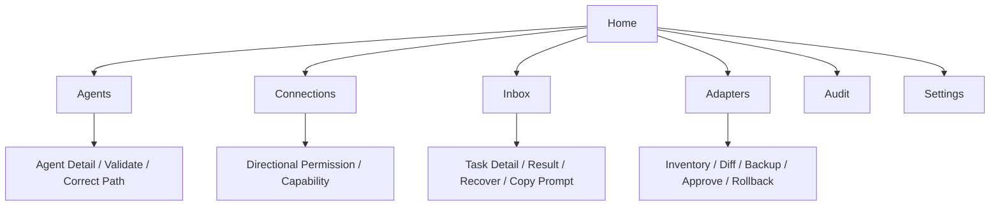

# Agent Relay 桌面交互规格

状态：0.1.0-preview.3。原生 WPF 界面支持英语、简体中文、繁体中文、日语、韩语和西班牙语。界面标签、已知状态、完整配置提示词、桌面任务/继续提示词、通知和配置解析错误跟随选择的语言；Agent ID、协议字段、原始 JSON、路径、任务正文与外部诊断保留原文。

## 页面结构



主窗口初始 `1120 × 780`，最小 `900 × 620`，左侧导航宽 178 px。顶栏包含页面名、可换行的模式说明、语言菜单和明确的刷新按钮。右上语言入口首次使用即可操作，与设置页同步。内容区纵向滚动，底栏显示数据目录、操作结果及独立的外部账本提示。

单行按钮、输入框、下拉框高度为 34 px，同组字段的标签和控件对齐；多行回复、任务证据与预览按内容用途独立设高。导航使用 20 px 线条图标、选中竖线与加粗文字。长导航文字、表格内容和路径显示省略号，悬停可看全文。交互支持键盘焦点、文本选择和复制。

`Home` 显示已登记 Agent、待处理任务、需要关注和保留天数四项事实。待处理任务统计非终态；需要关注统计失败、超时、投递未知以及成功后仍需人工继续的任务，按任务去重。下方提供需处理任务及复制提示词、查看证据和恢复操作。

| 页面 | 主要信息与动作 |
| --- | --- |
| `Agents` | Agent ID、宿主/版本、配置路径、验证状态；发现、登记、验证、纠正路径 |
| `Connections` | 有向图与完整权限表；选择一个方向查看权限、能力和原因，并独立设置允许或拒绝 |
| `Inbox` | 任务路线、状态、下一步、截止时间；请求/结果、证据、复制提示词、恢复、批准派发、重试、取消；持久通知及标记已读 |
| `Adapters` | 适配器及验证证据；配置盘点、来源登记、迁移预览、批准、验证与回滚 |
| `Audit` | 时间、任务、事件、操作者和详情；支持按任务 ID 筛选，不在列表默认展示任务正文 |
| `Settings` | 语言、配色、强调色；TTL、任务时限、运输时限与重试上限；清理预览及批准；Windows 通知辅助程序 |

## 语言与外观

首次启动跟随支持的系统语言，未匹配时使用英语。语言和配色选择后立即保存，同一 Relay 数据目录重启后保持；切换时保留表单草稿与待解析回复。新数据目录默认雾蓝，已有偏好保持原有选择。另提供鼠尾草、暖陶和玫瑰灰。

自定义强调色使用 `#RRGGBB`，输入时显示实时色块预览，无效格式显示就地错误；单独点击保存强调色后应用。清空并保存恢复当前配色的强调色。按钮实际强调色按文字可读性调整，固定的连接语义色不跟随自定义强调色变化。

偏好保存在 Relay 数据目录的 `desktop.preferences.json`。配置助手复制当前语言的提示词，严格解析固定 JSON 回复，仅填入非空字段。解析失败不部分代填；保存、路径验证和批准各自独立。完整流程见 [配置助手与外观](CONFIGURATION_ASSISTANT.md)。

## 有向图语义

- 绿色：通信允许。
- 红色：通信明确拒绝。
- 灰色：通信能力当前不可用，详情说明原因。

状态同时提供文字说明，箭头只表示一个方向。未配置权限按默认拒绝处理，区别于明确拒绝。3 个及以下 Agent 绘制全部方向，默认拒绝使用虚线；4 个及以上只绘制明确设置的允许或拒绝，图下说明默认拒绝已折叠。完整表格始终列出全部方向。

反向边使用相反侧的曲线，箭头在节点边界外结束，节点文字位于连线上层。连线具有较宽点击区域，点击后选中对应表格行，可用 Enter 或空格选择聚焦的连线。悬停展示权限、能力与原因。

权限允许但能力不可用时，边显示灰色，详情保留允许权限；明确拒绝时显示红色，能力独立呈现。点击 A→B 只编辑该方向。允许只修改 Relay 路由，不修改宿主原生权限；停用旧入口另有独立迁移批准流程。

## 任务交互

任务列表显示路线、当前状态、下一步动作和截止时间；详情包含提示词、原始记录、运输证据和审计。任务状态分别呈现，不把运输接受、ack、执行中或写文件视为成功完成。

人工派发明确显示待手工投递，复制的提示词包含接收方、请求路径、尝试 ID、结果路径及显式 ack/complete/fail 要求。等待任务提示当前轮结束，等待继续消息或用户粘贴提示词。

结果到达后可复制当前界面语言的继续提示词，例如简体中文：

```text
继续处理 Agent Relay 任务 {task_id}，当前状态 {state}。
请求文件：{request_path}
结果文件：{result_path}
请先读取结果及验证信息，再继续原任务。无需重复派发该任务。
```

结果过期或缺失时明确提示检查任务记录并决定是否重新生成。复制不执行命令或模拟键盘粘贴。CLI 的 `relay prompt show` 保留其原有输出契约。

投递未知或执行结果未知时，提示先查看相应证据，不自动重发或再次启动 Agent。重试展示已有状态，须给出理由并明确批准后创建新尝试；桌面重试不自动启动执行 worker。超时说明未收到有效完成结果，宿主可能仍在执行。取消只停止 Relay 后续派发，不终止已启动的宿主。

## 通知和刷新

等待、结果就绪、失败、超时、投递未知及恢复失败写入持久 Inbox，按任务和事件去重。列表显示可读事件及已读/未读状态；悬停行显示原始事件键和消息。标记已读只改通知，不改任务状态。

启用的 Windows 通知辅助程序可由完成事件启动，程序退出后仍支持点击激活。通知关闭时结果仍保留在 Inbox。当前没有系统调度器，所有进程退出后的截止时间在下次恢复时处理，设置页明确显示此行为。

GUI 启动读取持久状态并做一次显式恢复。Windows 的 SQLite 写事务提交后发布不含任务内容的窗口消息，并携带发送进程 ID。本窗口忽略自己的提交提示，由操作结果显示成功状态；外部进程提交时，Home/Inbox 合并事件后只读刷新，其他页面保留编辑与预览，在独立底栏提示账本有变化、可刷新。

外部提示不覆盖当前操作结果。刷新只读取账本；恢复会处理待投递和继续操作，可能调用已验证适配器。界面无文件 watcher 或周期状态查询，手动刷新始终可读取当前账本。

## 配置与迁移

路径无效时展示登记路径和失败原因，纠正后重新验证。配置助手仅提供表单输入，不能替代文件核验。迁移按 [ADAPTERS](ADAPTERS.md#迁移与回滚) 展示精确差异、备份、批准和回滚；应用和回滚须填写理由并明确批准。旧机制禁用使用独立、可见的影响说明和批准流程。
