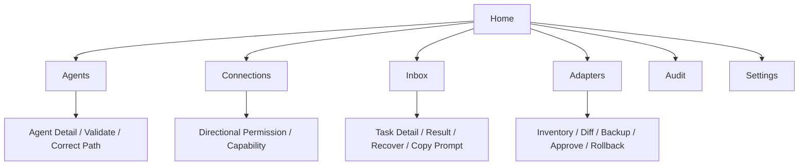

# Agent Relay 桌面交互规格

状态：Phase 5 已实现，使用与验证见 [PHASE5](PHASE5.md)。界面采用紧凑 Windows 桌面布局，技术标签用 English，说明与错误信息使用中文。

## 页面结构



主窗口建议初始 `1000 × 680`，左侧约 168 px 导航；顶栏为页面名、明确的 `Refresh`、通知入口。内容按任务列表和右侧详情组织，窄窗口切换为详情页；支持键盘焦点、文本选择和复制。状态使用图标和文字，不能只用颜色。

`Home` 显示四项事实：`Registered Agents`、`Pending Tasks`、`Needs Attention`、`Retention: 3 days`。`Pending Tasks` 统计非终态；`Needs Attention` 统计失败、超时、投递未知以及需要人工继续的任务，去重计数。下方仅展示需要处理的任务与 `Copy Continuation Prompt`、`Inspect`、`Recover`，不放装饰性图表。

| 页面 | 主要信息与动作 |
| --- | --- |
| `Agents` | Agent ID、宿主/版本、配置档、精确路径、验证时间；`Discover`、`Register`、`Validate`、`Correct Path` |
| `Connections` | 有向图及同等能力的可访问表格；点击边分别查看权限、能力及验证原因 |
| `Inbox` | Waiting、Ready、Needs Attention；任务、发送方、目标、截止时间和当前动作；结果文件及复制提示词 |
| `Adapters` | 适配器版本/来源/许可证、分项能力、验证证据；Inventory、Test、Migration Diff、Rollback |
| `Audit` | 时间、任务/尝试、事件、旧/新状态、操作者、运输凭据和错误；不默认展示任务正文 |
| `Settings` | 数据目录、默认 TTL、任务时限、重试上限、通知、明确启用的计划任务及其状态 |

## 有向图语义

- Green：通信允许。箭头只表示所指方向，不自动画反向边。
- Red：通信明确拒绝。
- Gray：通信能力不支持或当前不可用，详情说明原因。

未配置权限的组合按默认拒绝处理，用 `Default deny` 文字和虚线表示，不冒充明确拒绝。若权限允许但能力不可用，边显示 Gray，详情保留 `Permission: Allow`；若明确拒绝且能力也不可用，主边显示 Red，另列能力 Gray。未验证能力归为当前不可自动使用，标注 `Unverified`，不伪称宿主永久不支持。

点击 A→B 只编辑该方向；启用前展示当前能力与实际执行方式。`Allow` 只改 Relay 路由，不修改宿主原生权限。禁用旧插件入口有单独的迁移批准流程。

## 任务交互

任务详情依次显示当前状态、下一步动作、精确 Agent/会话、文件、事件时间线；运输状态与执行状态分别呈现。`Queued`、`Acknowledged`、`Running`、`Succeeded` 不互相替代。

派发后立即显示 `Waiting for Result`、任务 ID 和截止时间，提示 A 结束当前轮。人工模式明确显示 `Awaiting Manual Delivery`，提供给 B 的请求提示词。`confirm` 展示目标、工作目录、动作和批准按钮，不把等待批准显示成已派发。

结果到达时显示 `Result Ready`。恢复消息已经提交时显示 `Continuation Submitted`；不支持或失败时突出 `Copy Continuation Prompt`。示例模板：

```text
继续处理 Agent Relay 任务 {task_id}，当前状态 {state}。
请求文件：{request_path}
结果文件：{result_path}
请先读取结果及验证信息，再继续原任务。无需重复派发该任务。
```

产物过期时模板改为“结果文件已过期，请检查任务记录并决定重新生成”，不保留看似可用的文件路径。复制动作不自动执行、不模拟键盘粘贴；UI 提供按钮，CLI 提供 `relay prompt show`。

`Delivery Unknown` 的主动作是 `Reconcile` 和 `Inspect Evidence`；证据无法确认时显示人工处理。`Retry Execution` 展示已有尝试及可能重复执行，明确批准后新建尝试。失败显示失败报告；超时显示“未收到完成回调”，不宣称 B 已停止。`Cancel` 说明是否实际支持中止宿主。

## 通知和刷新

等待、结果就绪、失败/超时、投递未知及恢复失败均写入持久 Inbox。通知按任务和事件去重，重复回调不重复弹窗。用户确认已读仅改变通知状态，不改任务状态。

Windows 通知尝试由完成事件或已启用的单次计划任务触发，点击后打开任务详情；通知关闭时结果仍在 Inbox。没有调度器且所有进程退出时，下次 CLI/GUI 运行才处理漏掉的时限，Settings 明确显示 `Deadline Handling: On Next Command`。

GUI 启动读取持久状态并做一次显式恢复。Windows 的 SQLite 写事务提交后发布不含任务内容的窗口消息，Home/Inbox 合并事件并只读刷新；其他页面保留编辑与预览，显示 `Ledger changed · Refresh`。无文件 watcher 或周期状态查询。跨进程 UI 提示失败只影响刷新，用户刷新仍可读取账本。

## 配置与迁移

路径无效时展示原路径、来源和失败原因；`Correct Path` 后重新验证，不静默定位替代。迁移按 [ADAPTERS](ADAPTERS.md#迁移与回滚) 展示差异、备份、批准和回滚。任何旧机制的禁用都必须有独立、可见的具体影响说明。
